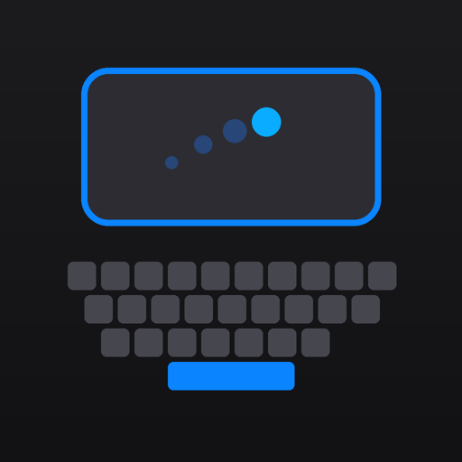

# PadDeck

Turn your iPhone or iPad into a wireless **keyboard, trackpad and Stream Deck-style
shortcut panel** for your Mac.

- **iPhone and iPad (iOS 16+):** [PadDeck on the App Store](https://apps.apple.com/app/id6838387257) — source in [`app/`](app/README.md)
- **Old jailbroken iPads (iOS 8–10):** PadDeck in the Cydia repo [douugr.github.io/repo](https://douugr.github.io/repo/) — source in [`ipad/`](ipad/)
- **Mac:** the free [PadDeck for Mac](https://github.com/douugr/paddeck/releases/latest) menu bar app — source in [`mac-agent/`](mac-agent/)

> **The Mac app works together with the iPhone/iPad app.** On its own it does nothing: it receives
> the touches and keys from PadDeck on your iPhone or iPad and turns them into pointer and keyboard
> events on the Mac. Install both.

Website: [douugr.github.io/paddeck](https://douugr.github.io/paddeck/)



- **Trackpad**: move, tap to click, two-finger tap for right click, two-finger scroll
  (natural or classic), double-tap-and-drag, three-finger swipes (Mission Control, App Exposé,
  switch Spaces), plus holdable click buttons.
- **Keyboard**: full Mac layout with esc/F1–F12, arrows and sticky ⌘ ⌥ ⌃ ⇧ (tap once for the
  next key, twice to lock). Text is sent as Unicode, so it works with any Mac keyboard layout.
  The **áç** key opens the iOS keyboard for accents, emoji and dictation.
- **Layout**: keyboard below or above the trackpad (Settings), or hidden for a full-screen trackpad.
- **Shortcuts**: 3 pages of 15 buttons. Each one sends a shortcut (`cmd+shift+4`), types text,
  opens an app or URL, or presses a media key. Hold a button to edit it.
- Finds the Mac automatically (Bonjour), pairs with a 4-digit PIN, reconnects by itself.
- **USB cable mode**: plug the iPad into the Mac and it connects by itself through usbmuxd
  (no PIN, lower and steadier latency, charges while you use it). Unplug and it falls back to Wi-Fi.

It has two parts: the iPad app and a small menu bar agent for the Mac. A version for current
iPads and iPhones (iOS 16+, no jailbreak) lives in [`app/`](app/README.md).

## Mac agent

**Download:** `PadDeck-mac.zip` from the [latest release](https://github.com/douugr/paddeck/releases/latest)
(macOS 12+, Apple silicon and Intel). Unzip, move **PadDeck** to Applications and open it.
It is signed with a Developer ID and notarized by Apple.

To build it yourself (Xcode or Command Line Tools):

```
cd mac-agent
./build.sh install     # builds PadDeck.app, copies it to /Applications and opens it
./build.sh release     # builds build/PadDeck-mac.zip (universal) for a GitHub release
```

On first launch macOS asks for **Accessibility** permission (System Settings › Privacy &
Security › Accessibility). It is needed to move the pointer and type. The PIN is shown in the
keyboard icon in the menu bar. If the firewall is on, allow incoming connections for PadDeck.

The agent is ad-hoc signed, so after rebuilding it you may need to remove and re-add it in the
Accessibility list.

## iPad app

Requirements: jailbroken iPad on iOS 8 to 10 (32-bit, armv7) with OpenSSH, a Mac with **Xcode 13.4.1** extracted
(only its toolchain is used; newer versions can't build armv7), `ldid` (`brew install ldid`).

```
cd ipad
export X13=/path/to/Xcode-13.4.1.app/Contents/Developer   # default: ../Xcode-13.4.1.app
export IPAD=192.168.x.x

./build.sh            # builds build/PadDeck.app
./build.sh install    # builds and installs on the iPad over SSH
./build.sh deb        # builds the .deb for a Cydia repo (needs: brew install dpkg)
```

Or install **PadDeck** from the repo `https://douugr.github.io/repo/` in Cydia or Melder.

## Protocol

Plain TCP + UDP on the local network, documented in [docs/PROTOCOL.md](docs/PROTOCOL.md).
Traffic is not encrypted; the PIN only keeps other devices from taking control, so use it on a
network you trust.

## License

MIT. Written with the help of an AI assistant (Claude).
